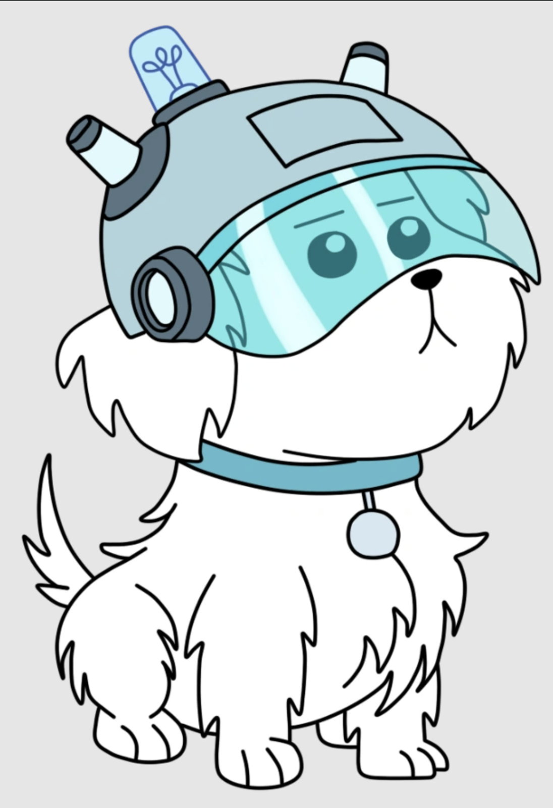
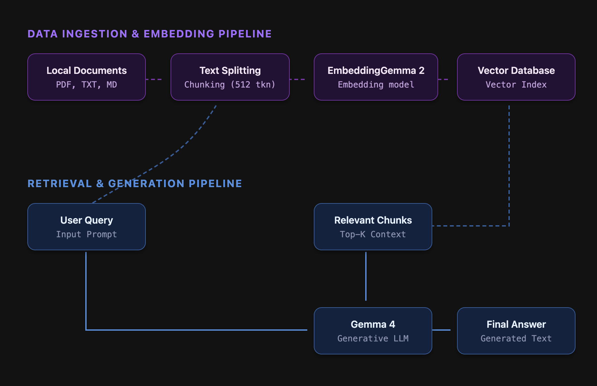

# Snuffles: Local Multi model RAG System

... I think he's saying "I love Lasagna" 
Snuffles is a fully local, private, and secure Retrieval-Augmented Generation (RAG) engine built in Python. The project aims to analyze documents (PDFs) and images by integrating local AI models and vector databases, with a strict focus on data privacy.

## Architecture and Tech Stack

- **Local:** All data, indexing, and vectorization are handled locally on the machine without external cloud calls.
- **Vector Database:** [ChromaDB](https://www.trychroma.com/) for persistent local storage of document embeddings.
- **Model Server:** [oMLX](https://github.com/omlx/omlx) running locally as the inference engine.
- **Models:**
  - `embeddinggemma-2` to convert text and documents into searchable vectors.
  - `gemma-4` for final text generation and multimodal analysis.