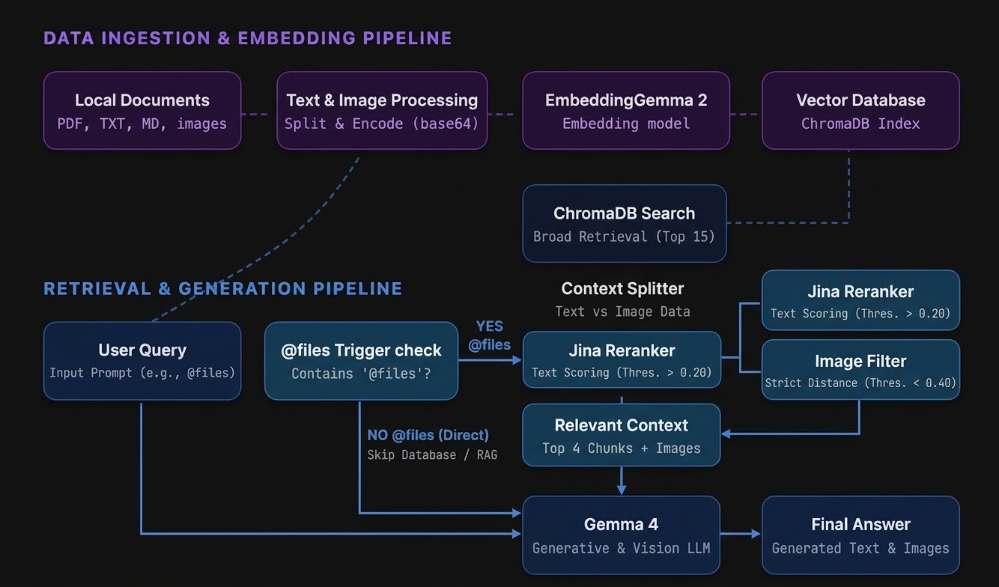

# Snuffles: Local Multi-Model RAG System

... I think he's saying "I love Lasagna" 

Snuffles is a local Retrieval-Augmented Generation (RAG) engine built in Python. The project aims to analyze documents (PDFs, Markdown, TXT) and images by integrating local AI models and vector databases, with focus on data privacy and local execution source based answers, running on Mac.

## Architecture and Tech Stack

- **Local & Private:** All data processing, indexing, and vectorization are handled strictly locally on the machine without cloud calls.
- **Trigger-Based RAG:** The document retrieval pipeline is entirely opt-in. The engine functions as a standard conversational assistant unless triggered with the `@files` command where your storage of documents are.
- **Vector Database:** [ChromaDB](https://www.trychroma.com/) for local storage of document and image embeddings.
- **Model Server:** [oMLX](https://github.com/omlx/omlx) running locally as the inference engine.
- **Models:**
  - `embeddinggemma-2-bf16` to convert text and documents into searchable semantic vectors.
  - `jina-reranker-v3-mlx` as a reranker to evaluate and score retrieved text chunks, actively reducing hallucinations and ensuring high-relevance context.
  - `gemma-4-E2B-it-MLX-8bit` for the final text generation and multimodal analysis.

## How the Retrieval Pipeline Works
When a user queries the system using the `@files` trigger, Snuffles bypasses standard chat mode and initiates a highly filtered two-step retrieval process:

1. **Broad Search (ChromaDB):** 
   The system initially casts a wide net, retrieving the top 15 candidate chunks based on mathematical vector distance (Cosine/L2).
   
2. **Context Splitter & Precision Reranking:**
   Because reranker models generally do not support image inputs, the pipeline splits the retrieved data:
   - **Text:** Sent to the local Jina Reranker model, which semantically scores each chunk strictly against the user's specific prompt. Only the absolute highest-scoring contexts (top 4) are appended to the generation prompt.
   - **Images:** Image relevance is enforced using a separate, highly aggressive ChromaDB distance threshold to guarantee that only exact matches bypass the filter.

This dual-filter approach ensures that the Gemma-4 model only receives verified, high-quality context, practically eliminating the risk of hallucinations caused by poor vector overlap.
